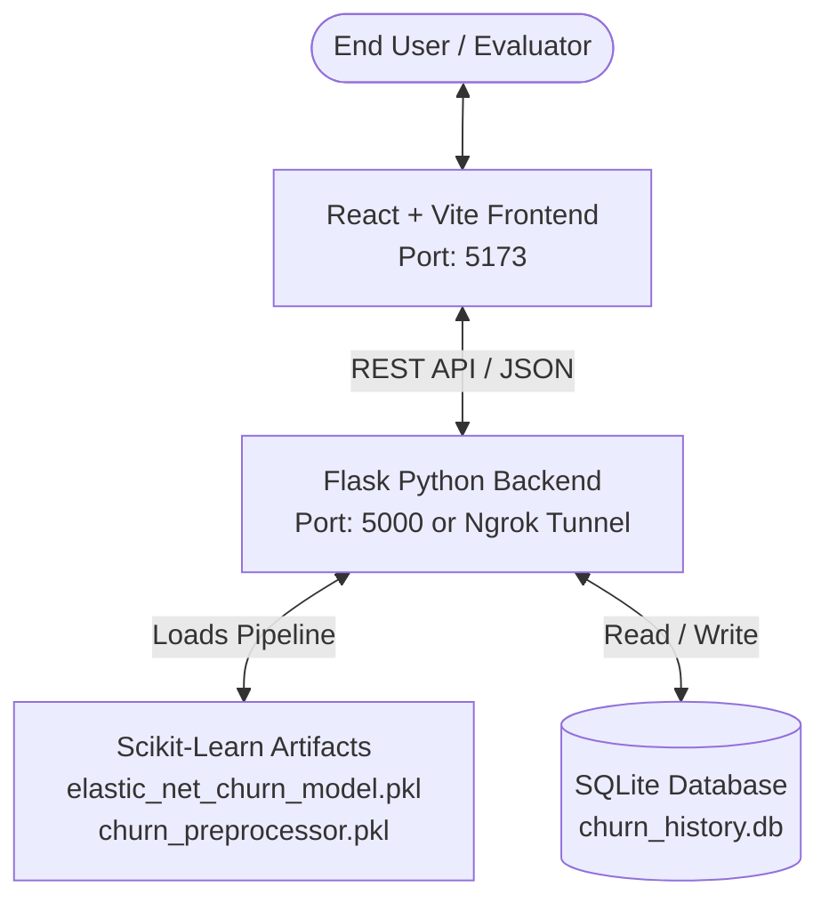

# Project Overview: Customer Churn Prediction Using Elastic Net Regularized Logistic Regression

## 1. Executive Summary

Customer churn is one of the most critical operational metrics in subscription and telecommunications businesses. Acquiring new customers typically costs five to seven times more than retaining existing accounts. This machine learning project implements an end-to-end predictive and analytical web application designed for college evaluation and practical business deployment.

The project evaluates customer churn using **Elastic Net Regularized Logistic Regression**, trained on the **IBM Telco Customer Churn dataset** (California telecommunications records).

---

## 2. Dataset Description & Preprocessing

### Original Dataset Characteristics
- **Total Samples**: 7,043 customer accounts across California.
- **Attributes**: 33 columns including customer demographics, services contracted, billing mechanisms, lifetime value (CLTV), and churn indicators.
- **Initial Target**: `Churn Label` (`No`: 5,174, `Yes`: 1,869).

### Preprocessing & Data Leakage Elimination
During the preliminary Exploratory Data Analysis (EDA) phase, multiple critical data quality issues were diagnosed and rectified:
1. **Handling Blank Numerical Values**: The `Total Charges` column contained 11 whitespace strings for new accounts with `Tenure Months = 0`. These were coerced to numerical floats via `pd.to_numeric()`, and the 11 invalid rows were removed, resulting in a clean dataset of **7,032 records**.
2. **Elimination of Target Leakage**: An initial experiment in the development notebook revealed an artificial 100% accuracy score. Investigation identified that post-hoc tracking fields—specifically `Churn Value` (identical numeric target), `Churn Score` (internal churn risk index), and `Churn Reason` (recorded strictly post-cancellation)—were improperly included. These leakage columns, along with geographical and arbitrary identifier keys (`CustomerID`, `Lat Long`, `Zip Code`, etc.), were systematically dropped.
3. **Final Feature Space**: 20 legitimate predictive variables were retained:
   - **4 Numeric Features**: `Tenure Months`, `Monthly Charges`, `Total Charges`, `CLTV`.
   - **16 Categorical Features**: `Gender`, `Senior Citizen`, `Partner`, `Dependents`, `Phone Service`, `Multiple Lines`, `Internet Service`, `Online Security`, `Online Backup`, `Device Protection`, `Tech Support`, `Streaming TV`, `Streaming Movies`, `Contract`, `Paperless Billing`, `Payment Method`.
4. **Scikit-Learn Pipeline**:
   - `StandardScaler` applied to continuous numerical variables to achieve zero mean and unit variance.
   - `OneHotEncoder(handle_unknown='ignore')` applied to categorical variables, expanding the input vector into **47 encoded dimensions**.
   - Preserved using `sklearn.compose.ColumnTransformer`.

---

## 3. Machine Learning Algorithm: Elastic Net Logistic Regression

Standard Logistic Regression models the probability of churn via the sigmoid link function:

$$P(y=1|x) = \sigma(w^T x + b) = \frac{1}{1 + e^{-(w^T x + b)}}$$

In high-dimensional feature spaces with correlated predictors (such as `Tenure Months`, `Monthly Charges`, and `Total Charges`), Ordinary Least Squares or unregularized logistic regression suffers from multicollinearity and variance inflation.

### The Elastic Net Regularization Penalty
Elastic Net combines both $L_1$ (Lasso) and $L_2$ (Ridge) penalties:

$$\min_{w, b} \left[ -\frac{1}{N} \sum_{i=1}^N \left( y_i \log(\hat{y}_i) + (1-y_i) \log(1-\hat{y}_i) \right) + \lambda \left( \alpha \sum_{j=1}^p |w_j| + \frac{1-\alpha}{2} \sum_{j=1}^p w_j^2 \right) \right]$$

Where:
- $\lambda = \frac{1}{C}$: Overall regularization strength.
- $\alpha = l1\_ratio$: The mixing parameter balance. When $\alpha = 0$, it is pure Ridge; when $\alpha = 1$, it is pure Lasso.
- In our tuned configuration:
  - **$C = 1.0$** ($\lambda = 1.0$)
  - **$l1\_ratio = 0.5$** (Equal combination of $L_1$ sparsity selection and $L_2$ shrinkage stability)
  - **Solver**: `saga` (Stochastic Average Gradient Descent adapted for non-smooth $L_1$ penalties and large feature dimensions).
  - **Max Iterations**: 1,000 convergence limit.

---

## 4. Evaluation Metrics & Verified Results

The model was evaluated on a stratified hold-out test set ($20\%$, $N=1,407$ records, preserving the class ratio of 73.4% Stay to 26.6% Churn):

| Metric | Verified Test Score | Business Significance |
|---|---|---|
| **Accuracy** | **80.74%** (0.8074) | Correctly classifies over 8 out of 10 customer accounts. |
| **Precision** | **64.67%** (0.6467) | When the model flags a customer as churning, it is correct ~65% of the time, avoiding excessive retention discount costs. |
| **Recall (Sensitivity)** | **60.70%** (0.6070) | Identifies 61 out of every 100 actual churners before they leave. |
| **F1-Score** | **62.62%** (0.6262) | Harmonic mean balancing false positives and false negatives under class imbalance. |
| **ROC-AUC** | **84.33%** (0.8433) | Strong discriminative ability across decision probability thresholds. |

### Confusion Matrix ($N=1,407$)
- **True Negatives (Correctly predicted Stay)**: 909
- **False Positives (Predicted Churn, actually Stayed)**: 124
- **False Negatives (Predicted Stay, actually Churned)**: 147
- **True Positives (Correctly identified Churn)**: 227

---

## 5. Key Feature Influences & Churn Drivers

Analysis of the Elastic Net model coefficients highlights the most influential features:

### Factors Strongly Driving Customer Churn (+ Coefficients)
1. **Month-to-Month Contract** ($+0.8015$): Absence of contractual commitment makes switching frictionless.
2. **No Dependents** ($+0.8009$): Individual accounts churn at higher rates than family/household accounts.
3. **Fiber Optic Internet** ($+0.6677$): Higher price points and aggressive competitor ISP promotions.
4. **Total Charges Accumulation** ($+0.6260$): Perceived spending burden over time.
5. **No Online Security** ($+0.4040$) & **No Tech Support** ($+0.3882$): Unassisted customer experiences.
6. **Electronic Check Payment** ($+0.3052$): Non-automated payment methods lead to higher churn propensity.

### Factors Strongly Protecting Retention (- Coefficients)
1. **Tenure Months** ($-1.3655$): Long-term relationship with the brand is the strongest statistical defense.
2. **Has Dependents** ($-0.8296$): Multi-user family accounts are significantly stickier.
3. **Two-Year Contract** ($-0.7100$) & **One-Year Contract** ($-0.4500$): Long-term agreements lock in customer loyalty.
4. **Active Online Security & Tech Support** ($-0.3800$): Value-added services deepen platform dependency.

---

## 6. System Architecture

